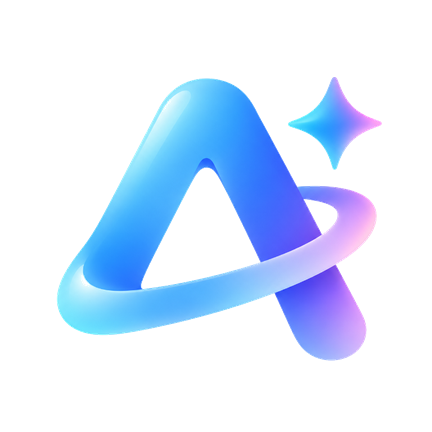

<div align="center">



# Aquarius AI

**Android 上的 AI 手机自动化引擎（定制改版）**

版本 **2.3.0**（versionCode 24） · 包名 `com.ai.phoneagent.aquarius`

仓库 <https://github.com/Enoogo/aquarius-ai> · 联系 <enoogo@qq.com>

</div>

---

## 仓库与联系

| 项 | 值 |
| --- | --- |
| 源码仓库 | <https://github.com/Enoogo/aquarius-ai> |
| 联系邮箱 | <enoogo@qq.com> |
| 包名 | `com.ai.phoneagent.aquarius` |
| 界面 | Material Design 3（中文 / English） |

---

## 关于本项目

本项目**改自开源项目 [Aries-AI](https://github.com/ZG0704666/Aries-AI)**（作者 ZG0704666，AGPL-3.0-only）。它在原版基础上做了一轮以「悬浮窗 + 任务可观测性 + 界面定制」为主的改造，并重命名为 **Aquarius AI**、更换了独立包名与图标，因此可以和官方原版同时装在一台手机上、互不干扰。

> 本项目不是 Aries-AI 官方版本，也未获官方背书。原版的所有权与著作权归原作者所有，详见 [许可证与合规](#许可证与合规)。

用自然语言描述目标，AI 会读取屏幕内容、规划步骤并通过无障碍服务替你点按、滑动、输入。

---

## 目录

- [核心特性](#核心特性)
- [本版（2.3.0）改动](#本版230改动)
- [历史改动总览](#历史改动总览)
- [快速开始](#快速开始)
- [技术架构](#技术架构)
- [目录结构](#目录结构)
- [从源码构建](#从源码构建)
- [权限说明](#权限说明)
- [已知限制](#已知限制)
- [常见问题](#常见问题)
- [许可证与合规](#许可证与合规)

---

## 核心特性

| 能力 | 说明 |
| --- | --- |
| **自然语言执行任务** | 一句话下发目标，Agent 主循环「截图 → 交给模型 → 解析动作 → 执行」逐步推进 |
| **元素级点击** | 模型只需给出控件文字，App 从无障碍 UI 树里解析 `bounds` 算出真实中心点，比纯坐标点击准得多 |
| **悬浮窗实时日志** | 302×238dp 常驻小窗，8.5sp 级别的高密度信息流，完整展示 AI 返回内容，可按步骤编号回溯 |
| **悬浮窗内下发新任务** | 右上角「＋」展开内嵌输入框，回车即执行，不用回主界面 |
| **用户接管保护** | 检测到真实手指触摸就暂停注入，停手 1 秒后重新截图再决策，避免和你的操作打架 |
| **任务历史留档** | 每个任务（含中途暂停、异常结束）都会落库成一条会话，附带完整操作日志 |
| **虚拟屏隔离** | 基于 Shizuku 的独立显示 + 定向输入，尽量减少任务对主屏的干扰（需授予 Shizuku 权限） |
| **多模型接入** | 第三方 OpenAI 兼容 API、Aquarius（原版）通行证、本地 MNN 模型三种模式 |
| **外观可调** | 明暗主题、5 套强调色、悬浮窗字号/按钮字号/触控热区/边框颗粒全部可配 |

---

## 本版（2.3.0）改动

| 改动 | 说明 |
| --- | --- |
| 品牌 | 全站图标/关于页/主页品牌区统一换成 `aquarius_logo.png` |
| 仓库信息 | 应用内源码入口与更新检查指向 <https://github.com/Enoogo/aquarius-ai>，联系邮箱 `enoogo@qq.com` |
| Material Design 3 | 液态玻璃材质整体退场：顶部「历史对话 / 主页 / 设置」改为 M3 `PrimaryTabRow`，返回键改为 M3 `IconButton` + Material Symbols `arrow_back`，卡片/按钮/开关统一为 M3 填充面与标准控件 |
| 语言 | 「外观 → 语言」新增 English；英文界面为极简文案，切换即时生效 |
| 悬浮窗设置 | 设置首页默认折叠为一个入口，点击进入独立设置页 |

## 本版（2.2.0）改动

1. **删除悬浮窗右上角「✕」**：功能与左下角「结束任务」完全重复，只留一个入口，避免误触。
2. **「＋」的点击优先级高于四角热区**：以前热区调大后会把「＋」的触摸吞掉，现在 `cornerAt()` 会先判断触摸点是否落在「＋」上（额外 6dp 容差），命中则交给按钮处理；「＋」本身也补到 32×28dp 的最小触摸面积。
3. **四角触控热区不再限制范围**：填多少就是多少，`0` 表示关闭四角拖拽。设置里不再出现「8–240」这类提示。
4. **边框颗粒开关**：设置 → 悬浮窗设置 → 「边框流光颗粒」。关闭后不是「画完再隐藏」，而是 `ValueAnimator` 直接不启动/被取消，`onDraw` 走静态分支，只画边框与进度段。
5. **统一品牌蓝 `#3964FE`**：原版的青色系（`#006C84` / `#38B6E3` / `#0AA3C2` / `#0E8FB5` / `#BCEBF4` 等，视觉上接近 `#3F798E`）全部映射到以 `#3964FE` 为基准的蓝色阶，覆盖主色、容器色、描边色、气泡、开关、按钮、图标与深色主题。
6. **悬浮窗字号可调**：新增 4 个输入项 —— 「悬浮窗字号」（状态行 + 日志正文 + 内嵌输入框）、「结束任务」字号、「隐藏 / 显示」字号、「＋」字号，单位 sp，不设上下限。改完立即生效，不必等下次任务。
7. **推荐任务文案**：新建对话页的「打开大众点评搜附近好吃的餐馆」改为「打开超星学习通并完成题目」。
8. **源码清理**：删除全部非必需的 `aries` 命名（类名、注释、文案、上游文档站与统计后端目录），保留项与原因见 [从源码构建](#从源码构建) 末尾的表格。

---

## 历史改动总览

| 版本 | 主要内容 |
| --- | --- |
| **1.x**（相对上游） | 悬浮窗重做：字号压小、信息密度提高、加粗「当前动作」、完整展示 AI 返回；暂停/失败任务也写入历史并附操作日志；启动默认开启任务模式 |
| **2.0.0** | 改名为 Aquarius AI、独立包名与 ♒ 图标，可与原版共存；新增新建对话；悬浮窗四角拖拽缩放 + 整体拖动；右下角「隐藏/显示」纯文字可拖动；左下角「结束任务」；移除语音模型；新增元素点击 |
| **2.1.0** | 去掉四角 L 形标记、热区扩到 40dp；振动改为系统键盘原生触感；全局 `aries → aquarius`；执行中检测到用户操作立即暂停、停手 1 秒后重新截图；删除麦克风权限引导；新增振动总开关、悬浮窗开关、热区半径输入、右上角「＋」新建任务、结束任务不关窗、删除步骤角标、图标波浪线改平行并换 `#3964FE` |
| **2.2.0** | 本版，见上 |

每一版的详细技术改动见 [HANDOVER.md](./HANDOVER.md)。

---

## 快速开始

### 安装

1. 下载 `Aquarius-AI-x.y.z-mod-arm64.apk`（arm64-v8a）。
2. 直接安装即可。因为它使用独立包名 `com.ai.phoneagent.aquarius`，**不会覆盖也不会冲突**官方版 Aries AI。
3. 首次启动按引导授予能力：**无障碍服务**（必需）、**悬浮窗**（必需）、**通知**（可选）。

### 第一次跑任务

1. 在设置 → 模型与 API 里填一个 OpenAI 兼容的 `Base URL` + `API Key`，或登录 Aquarius 通行证。
2. 回到主页，在输入框里写目标，例如「打开设置，把屏幕亮度调到 50%」。
3. 确认任务模式已开启（默认开启），点发送。
4. 悬浮窗出现后可以看到每一步的动作与模型返回；随时点「结束任务」中止。

---

## 技术架构

### 模块图

```
:app                     唯一 application 模块（包名 com.ai.phoneagent，applicationId 为 ...aquarius）
:core:common             JSON / 版本号等纯工具
:core:designsystem       Material 3 主题、m3t_* 设计令牌、玻璃拟态组件
:core:prompt             提示词仓库（PromptTemplates）
:core:shizuku            Shizuku 桥接（虚拟屏 / 高权限输入）
:feature:settings        设置页 UI
:feature:updates         GitHub Release 检查更新
```

### 任务执行链路

```
MainActivity / 悬浮窗「＋」
        │  下发 goal
        ▼
AutomationViewModel.startAgent()
        │  建会话 + 落库（AutomationTaskRepository）
        ▼
UiAutomationAgent.run()  ── 主循环 ──────────────────────────┐
        │  ① awaitUserInteractionIdle()  等用户停手 1s        │
        │  ② ScreenshotManager 截图（含缓存与节流）           │
        │  ③ 组装提示词（PromptTemplates）                    │
        │  ④ 调模型（流式），日志镜像到悬浮窗                  │
        │  ⑤ ActionParser 解析 do(action=...)                 │
        │  ⑥ ActionExecutor 执行                              │
        │      Tap → findElementCenter() 优先，坐标兜底        │
        │      Swipe / Input / Back / Home / Wait …           │
        └─────────────────────────────────────────────────────┘
```

- **日志双写**：`AutomationLogBridge` 用广播（带 `runId`）把每一行同时送到悬浮窗与主界面历史会话，保证「任务结束/暂停后还能翻日志」。
- **用户接管检测**：`PhoneAgentAccessibilityService` 监听 `TYPE_TOUCH_INTERACTION_START/END`，只对真实手指生效（自己 `dispatchGesture` 注入的手势会先 `markSelfInjectedGesture()` 打标，900ms 内不计入）。
- **元素定位**：`ActionUtils.findElementCenter(uiDump, text, contentDesc, resourceId, className, index)` 解析 `<node bounds="[x1,y1][x2,y2]">`，按 resourceId > text > contentDesc > className 的优先级取中心点。

### 悬浮窗

`AutomationOverlay` 是一个用 `WindowManager` + `TYPE_APPLICATION_OVERLAY` 挂上去的原生 `FrameLayout`（不是 Compose），刻意用原生 View 换取更低的启动开销与更可控的触摸分发。

| 组成部分 | 职责 |
| --- | --- |
| `AutomationOverlay`（外层） | 窗口增删、隐藏标签、`StateFlow<Boolean> visibleFlow` 供设置页同步 |
| `OverlayContainer` | 布局、四角缩放、整体拖动、内嵌输入、日志渲染 |
| `EdgeFlowView` | 边框流光：`PathMeasure` 沿圆角矩形取点，画进度段 + 颗粒；受 `particlesEnabled` 控制 |

触摸分发顺序（`OverlayContainer.dispatchTouchEvent`）：

```
DOWN
 ├─ 命中「＋」？        → 交给子 View（不缩放）   ← 优先级最高
 ├─ 命中底部操作栏？    → 交给子 View
 ├─ 命中输入行？        → 交给子 View
 ├─ 命中四角热区？      → 进入 resize
 └─ 其他                → super（拖动 / 滚动日志）
```

### 数据存储

| 存储 | 名称 | 内容 |
| --- | --- | --- |
| Room | `aries.db` | 会话与消息（历史库名，**不可改名**，否则老数据全丢） |
| Room | `aries_tasks.db` | 自动化任务记录（runId 主键、目标、状态、步骤、日志） |
| DataStore | `app_preferences` | 模型配置、主题、开关（键名前缀 `aries_`，同样保留） |
| DataStore | `telemetry_prefs` | 安装 ID 与心跳时间 |
| SharedPreferences | `aquarius_ui_prefs` | 振动、悬浮窗、热区、颗粒、字号等即时读取项 |

### 关键类

| 类 | 作用 |
| --- | --- |
| `AquariusAgentApp` | `Application`，启动 Koin |
| `MainActivity` | 主界面（Compose）：对话、抽屉、设置入口、悬浮窗权限 |
| `AutomationViewModel` | 任务调度中枢：启动/停止/暂停、悬浮窗开关、历史落库 |
| `UiAutomationAgent` | Agent 主循环与提示词编排 |
| `PhoneAgentAccessibilityService` | 无障碍服务：UI 树 dump、手势注入、触摸监听 |
| `ActionExecutor` / `ActionParser` | 动作执行与解析 |
| `AutomationOverlay` | 悬浮窗 |
| `AppUiPrefs` / `Haptics` | 界面偏好与统一触感入口 |

---

## 目录结构

```
.
├── app/                        # 唯一 application 模块
│   ├── src/main/java/com/ai/phoneagent/
│   │   ├── core/               # agent 主循环、动作解析/执行、工具、截图缓存、安全守卫
│   │   │   ├── settings/       #   AppUiPrefs / Haptics（本改版新增）
│   │   │   └── overlay/        #   OverlayTaskBridge（悬浮窗 ↔ ViewModel）
│   │   ├── data/               # Room / DataStore / 加密存储
│   │   ├── di/                 # Koin 模块
│   │   ├── net/                # API 客户端、SSE、OIDC
│   │   ├── ui/                 # Compose 界面（home / drawer / messages / settings / onboarding …）
│   │   ├── vdiso/              # Shizuku 虚拟屏引擎
│   │   ├── viewmodel/
│   │   └── AutomationOverlay.kt  # 悬浮窗（原生 View）
│   └── src/main/res/           # 图标、颜色、字符串（含 m3t_* 覆盖）
├── core/{common,designsystem,prompt,shizuku}/
├── feature/{settings,updates}/
├── UI design/                  # 设计稿（.pen）
├── HANDOVER.md                 # 给下一个 AI / 开发者的交接文档
└── README.md                   # 本文件
```

---

## 从源码构建

### 环境

| 项 | 版本 |
| --- | --- |
| JDK | 17（实测 Temurin 17.0.2） |
| Gradle | 9.4.1（用仓库自带 `./gradlew`） |
| AGP / Kotlin | 9.2.1 / 2.4.10 |
| compileSdk / targetSdk / minSdk | 37 / 36 / 30 |
| Build-Tools | 37.0.0 |

### 命令

```bash
# 1) 指定 SDK
echo "sdk.dir=/path/to/android-sdk" > local.properties

# 2) 编译 Release
./gradlew :app:assembleRelease
#    产物：app/build/outputs/apk/release/app-release-unsigned.apk

# 3) 16KB 页对齐（Android 15+ 设备必需，注意是 -P 16 不是 -p）
$ANDROID_HOME/build-tools/37.0.0/zipalign -P 16 -f 4 \
  app-release-unsigned.apk aquarius-aligned.apk

# 4) 签名（V1+V2+V3）
$ANDROID_HOME/build-tools/37.0.0/apksigner sign \
  --ks aquarius.jks --ks-key-alias aquarius \
  --v1-signing-enabled true --v2-signing-enabled true --v3-signing-enabled true \
  aquarius-aligned.apk

# 5) 自检
$ANDROID_HOME/build-tools/37.0.0/apksigner verify --verbose aquarius-aligned.apk
$ANDROID_HOME/build-tools/37.0.0/zipalign -c -P 16 4 aquarius-aligned.apk
```

### 与上游的命名差异

已删除：

- 目录 `Aries-site/`（Astro 站点 + VitePress 文档站，不参与构建）
- 目录 `telemetry-worker/`（Cloudflare Worker 统计后端，APK 不依赖）
- 类名 / 注释 / 文案里所有非必需 `aries`：`AriesAgentApp → AquariusAgentApp`、`AriesDatabase → AquariusDatabase`、`AriesApiClient → AquariusApiClient`，测试引用同步修正
- 「关于」页的「访问官网」入口（原指向 `aries-agent.com`，本项目没有官网，避免死链）

**故意保留**（改了会破坏兼容性，不是遗漏）：

| 保留项 | 原因 |
| --- | --- |
| 域名 `api.aries.org.cn` / `sso.aries.org.cn` | 官方服务端真实地址，改了登录与 API 全废 |
| `aries.db` / `aries_tasks.db` | 数据库文件名，改名等于清空用户历史 |
| DataStore 键 `use_aries_api` 等 | 改名等于清空用户模型配置 |
| KeyStore 别名 `aries_ai_preference_secrets` | 改名后已加密的 API Key 无法解密 |
| provider 标识 `"aries"` | 参与 `ApiConfigSignature` 计算，改了已存 Key 失效 |
| `LICENSE` / `NOTICE` 中的原始版权声明 | AGPL-3.0 强制要求保留，删除即违约 |

---

## 权限说明

| 权限 | 用途 | 必需 |
| --- | --- | --- |
| 无障碍服务（`BIND_ACCESSIBILITY_SERVICE`） | dump UI 树、注入手势 | 是 |
| 悬浮窗（`SYSTEM_ALERT_WINDOW`） | 显示任务悬浮窗 | 是 |
| 通知（`POST_NOTIFICATIONS`） | 前台服务常驻通知 | 建议 |
| Shizuku 授权 | 虚拟屏隔离与高权限输入 | 可选 |
| 麦克风 | **已移除**，本版不含任何语音功能 | — |

---

## 已知限制

- **没有真机自动化测试**：虚拟屏相关的部分依赖 Shizuku 与具体 ROM，行为差异较大。
- **个别 ROM 收不到触摸事件**：`TYPE_TOUCH_INTERACTION_*` 在少数深度定制系统上不回调，此时「检测到手动操作」不会触发，任务不会暂停。
- **悬浮窗内输入依赖窗口焦点**：少数 ROM 会拒绝给 `TYPE_APPLICATION_OVERLAY` 窗口派发输入法，此时点一下输入框本身通常可以唤起键盘。
- **热区填太大会挡住内容区**：四角热区不设上限，填得比窗口还大时整个窗口都会变成缩放区（「＋」「结束任务」「隐藏」仍可点），这是配置的必然结果，改小即可。
- **模型能力决定成功率**：任务完成度取决于模型、目标 App 与网络，不保证 100%。

---

## 常见问题

**Q：能和官方 Aries AI 同时装吗？**
能。包名是 `com.ai.phoneagent.aquarius`，数据沙盒、FileProvider、Shizuku 授权全部独立。

**Q：覆盖安装旧版 Aquarius AI 要卸载吗？**
不用，同签名可覆盖升级。若提示「应用未安装」，多半是签名不一致（比如装过别处签的包），卸载后重装即可。

**Q：桌面图标还是旧的？**
系统会缓存 adaptive icon，长按图标 → 编辑，或重启桌面。

**Q：关掉悬浮窗开关，任务还会正常跑吗？**
会。开关只控制「窗口是否显示」，任务照常执行；开始新任务时会自动把窗口显示出来并把开关同步回「开」。

**Q：结束任务后窗口为什么还在？**
2.1.0 起的行为：结束任务只终止任务，窗口保留以便查看日志、直接下发新任务。要彻底关窗请用设置里的悬浮窗开关。

---

## 许可证与合规

- 本项目基于 [Aries-AI](https://github.com/ZG0704666/Aries-AI) 修改，原项目采用 **AGPL-3.0-only**，本项目沿用同一许可证，全文见 [LICENSE](./LICENSE)。
- 原始版权声明保留在 [NOTICE](./NOTICE)，请勿删除。
- 按原项目 [TRADEMARK.md](./TRADEMARK.md) 的要求，本项目**已重命名**为 Aquarius AI、更换图标与包名，不以 Aries AI 名义分发，也不暗示与原作者存在官方关系。
- 使用本软件执行自动化操作时，请自行确认目标应用的服务条款与当地法律法规。

---

<div align="center">

改自 [Aries-AI](https://github.com/ZG0704666/Aries-AI) · AGPL-3.0-only

</div>
